# Brotato QoL Mods

A collection of 21 mods for [Brotato](https://store.steampowered.com/app/1942280/Brotato/): quality-of-life features, cheats, new items, a new character and gameplay tweaks.

*Eine Sammlung von 21 Mods für Brotato – Komfortfunktionen, Cheats, neue Items, ein neuer Charakter und Gameplay-Anpassungen. Alle Mods sind auch im Steam Workshop verfügbar (Links in der Tabelle).*

## Mods

| | Mod | Version | Description | Requires DLC | ModOptions | Steam |
|---|---|---|---|---|---|---|
| 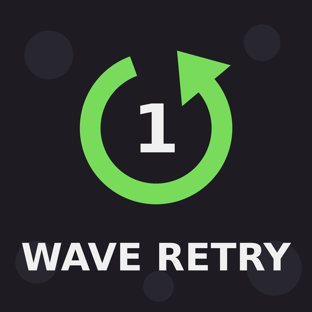 | **[WaveRetry](mods/WaveRetry)** | 1.0.0 | Retry the current wave from the pause menu or after dying. Retries are not counted in your records. | – |  | [Workshop](https://steamcommunity.com/sharedfiles/filedetails/?id=3833170469) |
| 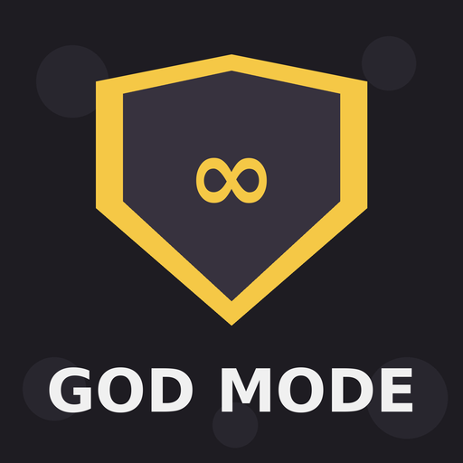 | **[GodMode](mods/GodMode)** | 1.0.0 | Toggleable god mode: the player takes no damage. Switch it on and off in the pause menu. | – |  | [Workshop](https://steamcommunity.com/sharedfiles/filedetails/?id=3833176122) |
| 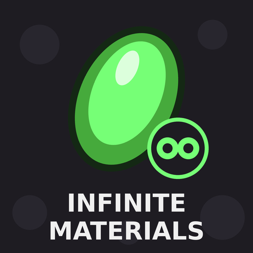 | **[InfiniteMaterials](mods/InfiniteMaterials)** | 1.2.0 | Adds a toggle to the shop: while it's on, rerolls and all items are free. | – |  | [Workshop](https://steamcommunity.com/sharedfiles/filedetails/?id=3833180466) |
| 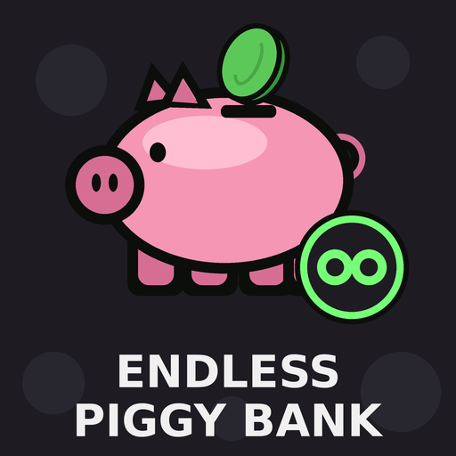 | **[EndlessPiggyBank](mods/EndlessPiggyBank)** | 1.1.0 | The Piggy Bank keeps working after wave 20 (endless mode). | – | ✓ | [Workshop](https://steamcommunity.com/sharedfiles/filedetails/?id=3833195004) |
| 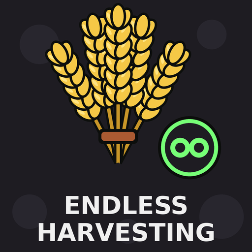 | **[EndlessHarvesting](mods/EndlessHarvesting)** | 1.1.0 | Harvesting keeps growing after wave 20 (endless mode) instead of shrinking by 20% every wave. | – | ✓ | [Workshop](https://steamcommunity.com/sharedfiles/filedetails/?id=3833197625) |
| 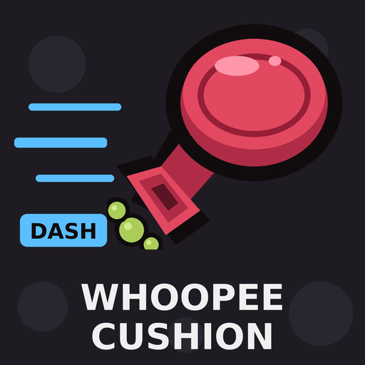 | **[FartCushion](mods/FartCushion)** | 1.3.1 | Adds the Whoopee Cushion item: dash with Shift or L3 on the controller (rebindable via ModOptions). Cooldown 3s, reduced by attack speed. | – | ✓ | [Workshop](https://steamcommunity.com/sharedfiles/filedetails/?id=3833217875) |
| 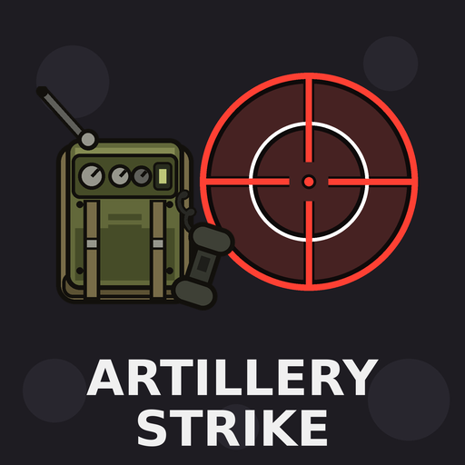 | **[ArtilleryStrike](mods/ArtilleryStrike)** | 1.1.0 | Adds the Artillery Strike item: every 15s a crosshair appears at a random spot and an artillery shell hits it 3s later. | – |  | [Workshop](https://steamcommunity.com/sharedfiles/filedetails/?id=3833720128) |
| 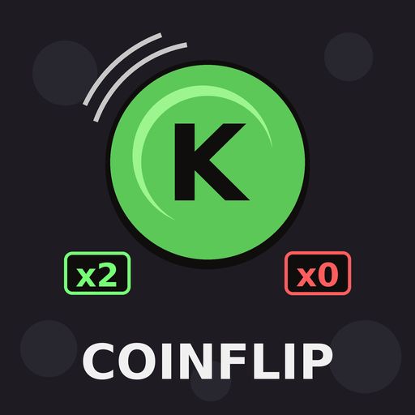 | **[Coinflip](mods/Coinflip)** | 1.0.0 | At the end of every wave, bet all materials you collected in that wave on a coin flip: heads, tails or skip. | – |  | [Workshop](https://steamcommunity.com/sharedfiles/filedetails/?id=3833711559) |
| 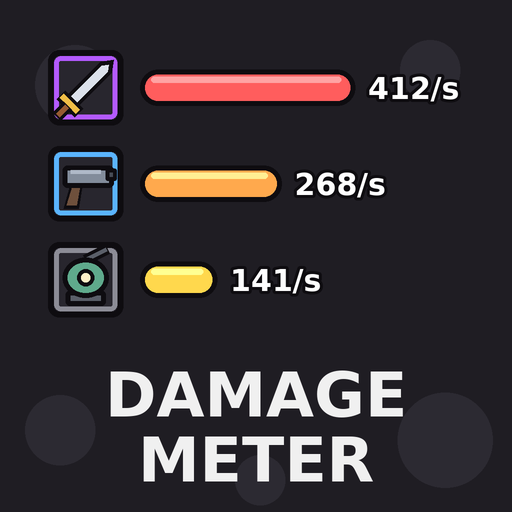 | **[DamageMeter](mods/DamageMeter)** | 1.0.1 | Shows damage per second and total damage of every weapon and item during a wave. Configurable with ModOptions. | – | ✓ | [Workshop](https://steamcommunity.com/sharedfiles/filedetails/?id=3833748785) |
| 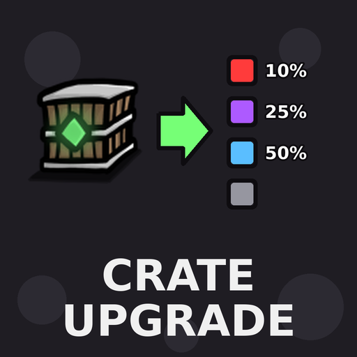 | **[CrateUpgrade](mods/CrateUpgrade)** | 1.1.1 | Gamble collected crate items at the end of a wave: upgrade them to the next rarity (50% / 25% / 10%) - or lose them. | – |  | [Workshop](https://steamcommunity.com/sharedfiles/filedetails/?id=3833755054) |
| 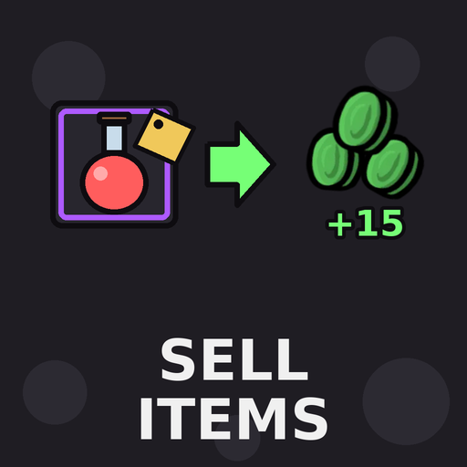 | **[SellItems](mods/SellItems)** | 1.2.0 | Sell items you own in the shop. Sold unique items can be bought again. Optional sell limit per run via ModOptions. | – | ✓ | [Workshop](https://steamcommunity.com/sharedfiles/filedetails/?id=3834096065) |
| 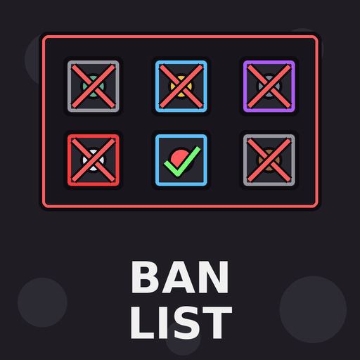 | **[BanList](mods/BanList)** | 1.3.0 | Ban items and weapons in the shop so they don't show up anymore this run. A ban list lets you lift bans again. Optional ban limit via ModOptions. | – | ✓ | [Workshop](https://steamcommunity.com/sharedfiles/filedetails/?id=3834099421) |
| 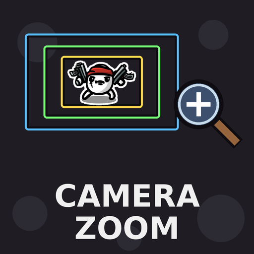 | **[CameraZoom](mods/CameraZoom)** | 1.0.0 | Zoom the game camera in or out to see less or more of the map. Configurable with ModOptions. | – | ✓ | [Workshop](https://steamcommunity.com/sharedfiles/filedetails/?id=3834105742) |
| 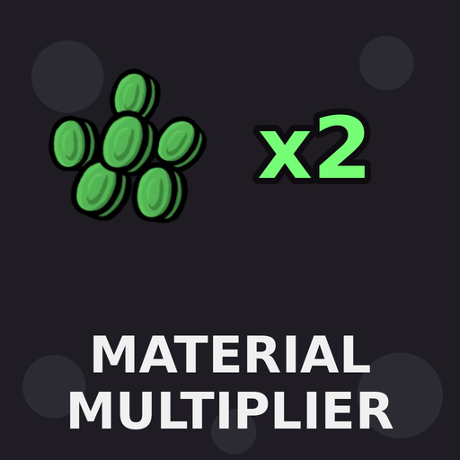 | **[MaterialMultiplier](mods/MaterialMultiplier)** | 1.0.0 | Collected materials are multiplied (default x2, up to x100 with ModOptions). | – | ✓ | [Workshop](https://steamcommunity.com/sharedfiles/filedetails/?id=3834107839) |
| 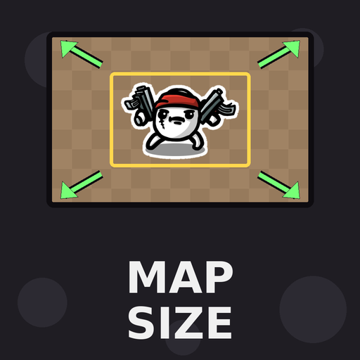 | **[MapSize](mods/MapSize)** | 1.0.0 | Make the arena bigger or smaller with a slider in ModOptions. | – | ✓ | [Workshop](https://steamcommunity.com/sharedfiles/filedetails/?id=3834113480) |
| 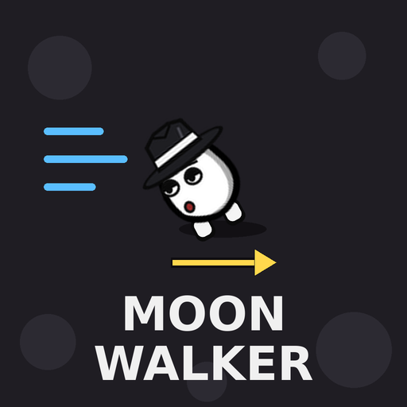 | **[Moonwalker](mods/Moonwalker)** | 1.0.0 | New character: The Moonwalker. Reversed controls - he always glides backwards and leans further and further forward during the wave. | – |  | [Workshop](https://steamcommunity.com/sharedfiles/filedetails/?id=3834194390) |
| 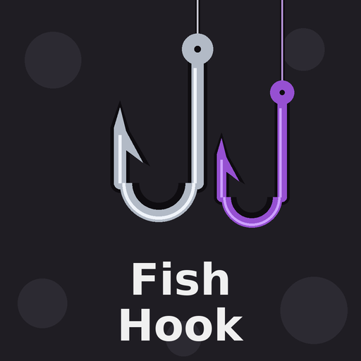 | **[FishHook](mods/FishHook)** | 1.1.0 | Killing Elites and Bosses can give you a Fish Hook (normal or cursed). Adjustable chances in ModOptions, optional start with a Fish Hook. Requires Abyssal Terrors. | Abyssal Terrors | ✓ | [Workshop](https://steamcommunity.com/sharedfiles/filedetails/?id=3834853628) |
| 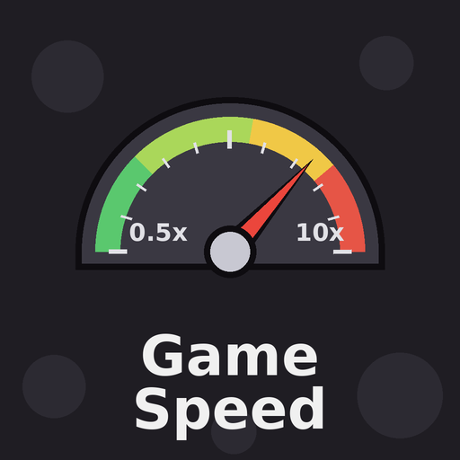 | **[GameSpeed](mods/GameSpeed)** | 1.0.0 | Change the game speed during waves (0.5x - 10x) with a slider in ModOptions. | – | ✓ | [Workshop](https://steamcommunity.com/sharedfiles/filedetails/?id=3834871666) |
| 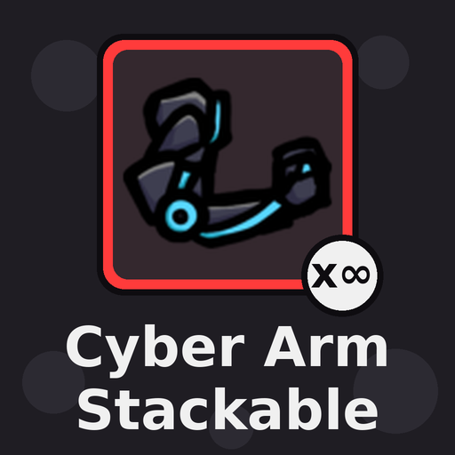 | **[StackableCyberArm](mods/StackableCyberArm)** | 1.0.0 | The Cybernetic Arm is no longer unique and can be bought multiple times (+1 weapon slot each). Requires Primal Dread. | Primal Dread |  | [Workshop](https://steamcommunity.com/sharedfiles/filedetails/?id=3834876738) |
| 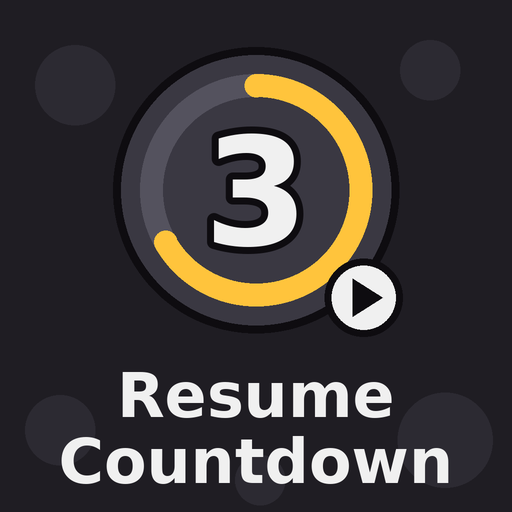 | **[ResumeCountdown](mods/ResumeCountdown)** | 1.0.0 | After leaving the pause menu during a wave, a countdown (default 3s, 1-10s via ModOptions) is shown before the game continues. | – | ✓ | [Workshop](https://steamcommunity.com/sharedfiles/filedetails/?id=3836740945) |
| 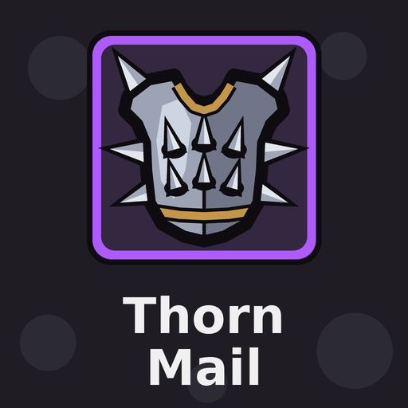 | **[Thornmail](mods/Thornmail)** | 1.0.0 | Adds the Thornmail: a rare item (+3 armor) that reflects damage you take back to the attacker. Damage multiplier adjustable in ModOptions. | – | ✓ | [Workshop](https://steamcommunity.com/sharedfiles/filedetails/?id=3836820420) |

**ModOptions ✓** = settings can be changed in-game with [ModOptions](https://steamcommunity.com/sharedfiles/filedetails/?id=3598984651) (optional – without it the mods use their default settings).

## Credits

- **FishHook** is based on the idea of [WeNeedFishHook](https://steamcommunity.com/sharedfiles/filedetails/?id=3776832030), which is outdated – rewritten with features requested in its comments.
- In-game settings are provided through [ModOptions](https://steamcommunity.com/sharedfiles/filedetails/?id=3598984651).

## Requirements

- Brotato **1.2.0.1** (with the built-in ModLoader 6.3.0)
- Optional: [ModOptions](https://steamcommunity.com/sharedfiles/filedetails/?id=3598984651) for in-game settings
- FishHook needs the *Abyssal Terrors* DLC, StackableCyberArm needs the *Primal Dread* DLC

## Installation

**Steam Workshop (recommended):** subscribe to the mods via the Workshop links above.

**Manual:**
1. Pick a mod in [`mods/`](mods) and zip its `mods-unpacked` folder, so the zip contains `mods-unpacked/BrotatoQoL-<Name>/...`
2. Put the zip into the `mods` folder next to `Brotato.exe` (create it if it doesn't exist), e.g.
   `C:\Program Files (x86)\Steam\steamapps\common\Brotato\mods\<Name>.zip`
3. Start the game and enable the mod in the *Mods* menu.

## Structure

```
mods/
  <ModName>/
    preview.png                       Workshop preview image
    mods-unpacked/
      BrotatoQoL-<ModName>/
        manifest.json                 ModLoader manifest
        mod_main.gd                   entry point
        extensions/ ...               script extensions (if any)
```

All mods are written in GDScript for Godot 3 and use the [Godot Mod Loader](https://github.com/GodotModding/godot-mod-loader) (6.3.0) that ships with Brotato.

## License

[MIT](LICENSE)
